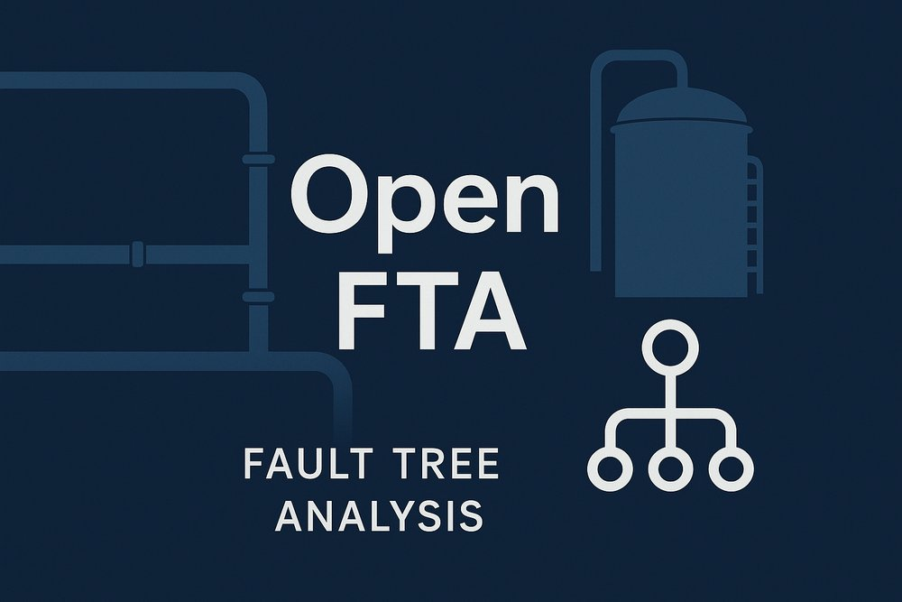
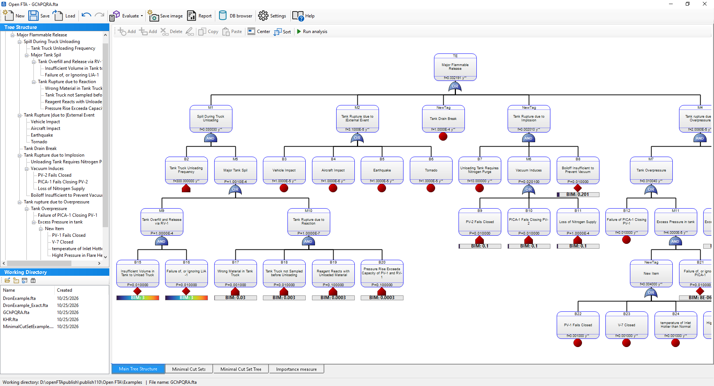
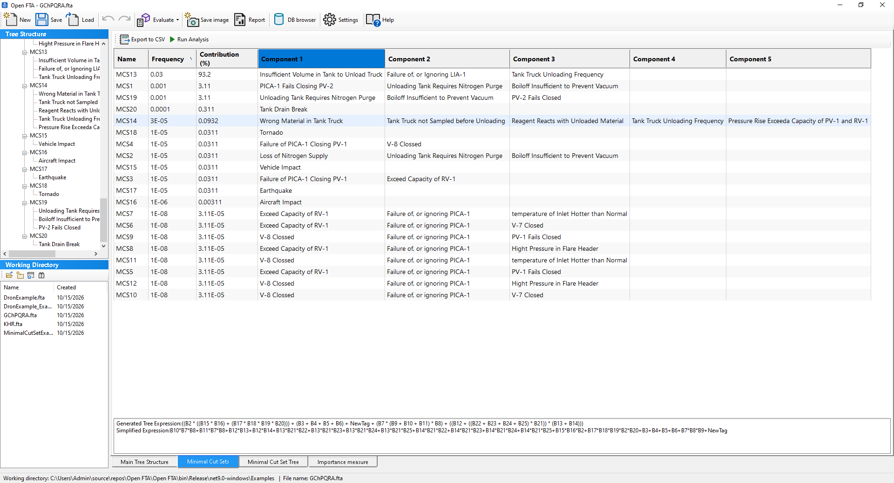
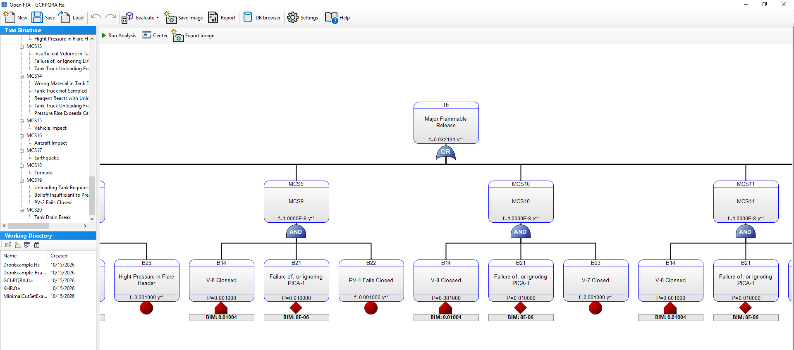
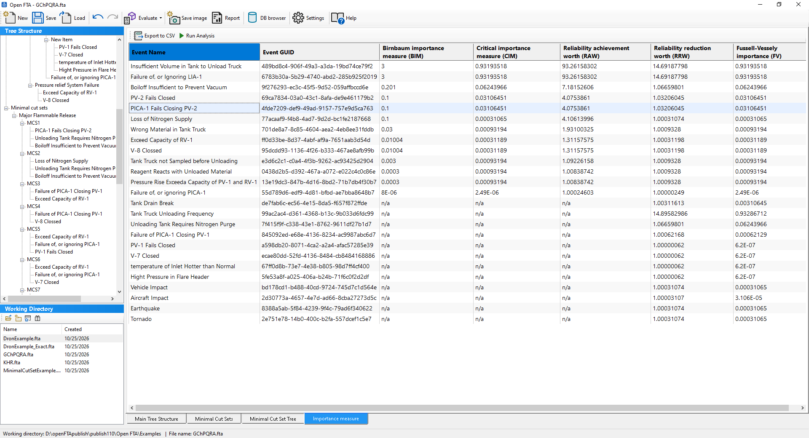
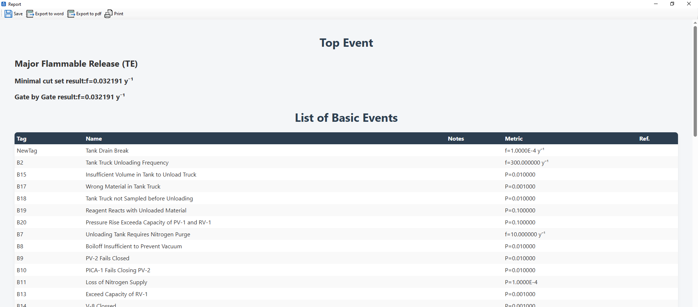

<p align="center">
  
</p>

<p align="center">
  <a href="https://github.com/duroLAB/Open-FTA/releases/latest"></a>
  
  
  <a href="Open%20FTA/LICENSE"></a>
</p>

**Open FTA** is a simple application for **fault tree analysis** in the safety assessment of the chemical and process industry. It serves as a **teaching tool** for chemical engineers and as a **free, open-source alternative** to commercial systems.

Because it is open source, the calculations can be checked and audited, and the application can be extended and adapted to specific needs. It can be used in **research projects** and in **teaching**, for example in courses on process safety.

<p align="center">
  
</p>

---

## Key features

- **Fault tree editor** – top event, intermediate events, basic events, AND / OR gates, copy and paste of subtrees, undo and redo.
- **Top event frequency or probability** – calculated gate by gate and from the minimal cut sets.
- **Minimal cut sets (MCS)** – list of the cut sets, highlighting in the tree and drawing of the **minimal cut set tree**.
- **Importance measures** of basic events – Birnbaum (BIM), criticality (CIM), RAW, RRW and Fussell–Vesely (FV).
- **Reliability database** – browser for easier assignment of frequencies and probabilities of basic events, with references.
- **Automatic layout** of the tree, including the compact tidy-tree algorithm (ALGO III), suitable also for large trees.
- **Reports** – top event result, list of basic events with references, minimal cut sets and importance measures.
- **Export** of the fault tree and of the minimal cut set tree as a bitmap or vector image.
- Example trees in the `Examples` folder.

## Screenshots

| Minimal cut sets | Minimal cut set tree |
|:---:|:---:|
|  |  |
| **Importance measures** | **Report** |
|  |  |

## Installation

1. Open the [latest release](https://github.com/duroLAB/Open-FTA/releases/latest).
2. Download `OpenFTA-<version>-win-x64.zip`.
3. Extract the ZIP to a folder of your choice. Keep all files together – the application needs the files next to the executable.
4. Run `Open FTA.exe`.

**Requirements:** Windows 10 or 11 (64-bit). No .NET installation is needed – the runtime is included. Reports and help use the Microsoft Edge WebView2 Runtime, which is preinstalled on Windows 11 and on updated Windows 10.

## Quick start

1. Click **Load** and open one of the examples, e.g. `Examples\GChPQRA.fta`.
2. Click **Run analysis**.
3. Look at the result of the top event in the tree and browse the tabs **Minimal Cut Sets**, **Minimal Cut Set Tree** and **Importance measure**.
4. Click **Report** to create a report, or **Save image** to export the tree.

Under **Settings** you can choose the calculation options, the base time unit, the size and spacing of events and the layout algorithm. Settings are kept after restart.

## Building from source

Requirements: [.NET 10 SDK](https://dotnet.microsoft.com/download/dotnet/10.0) and Windows. Visual Studio 2026 is recommended.

```powershell
git clone https://github.com/duroLAB/Open-FTA.git
cd Open-FTA
dotnet build "Open FTA.sln"
dotnet test  "Open FTA.sln"
```

Self-contained single-file build for distribution (output folder is set in the profile):

```powershell
dotnet publish "Open FTA\Open FTA.csproj" -c Release -p:PublishProfile=FolderProfile
```

### Repository structure

| Folder | Content |
|---|---|
| `Open FTA/engine` | Calculations, minimal cut sets, importance measures, tree layout, drawing, saving |
| `Open FTA/forms` | Windows Forms dialogs and views |
| `Open FTA/help` | Built-in help (Markdown) |
| `Open FTA/Examples` | Example fault trees (`.fta`) |
| `OpenFTA.Tests` | Automated tests (xUnit), including snapshot tests of the examples |

## Changelog

See [Changelog.md](Open%20FTA/Changelog.md) for the list of changes in each version.

## Background

The application is based on the diploma thesis of M. Doller: [“Design of a Software System for Fault Tree Analysis”](https://kis.cvt.stuba.sk/arl-stu/sk/detail-stu_us_cat-stuzp105108-Navrh-softveroveho-systemu-na-analyzu-stromu-poruch/) (Slovak University of Technology in Bratislava).

## License

Open FTA is released under the [MIT License](Open%20FTA/LICENSE).
